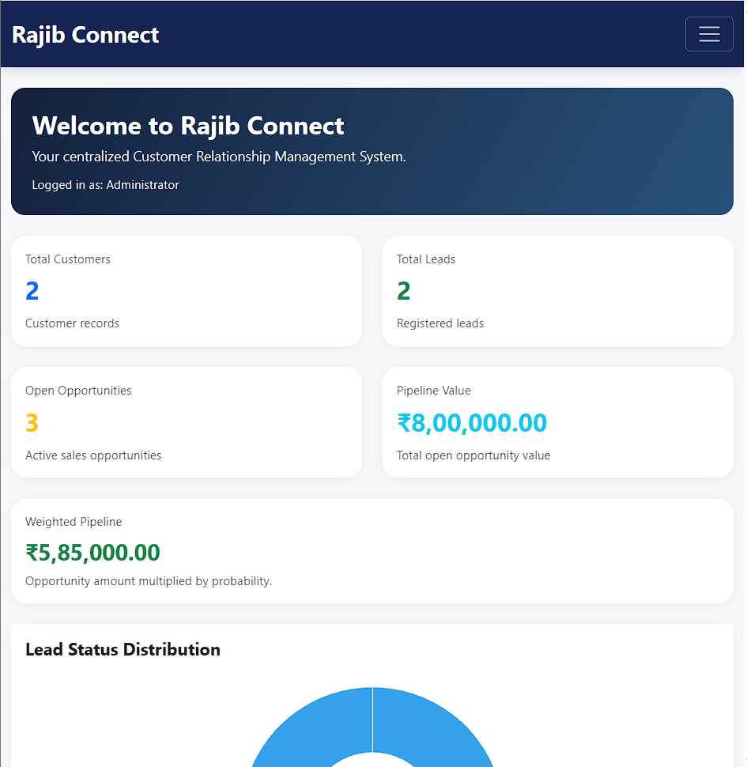
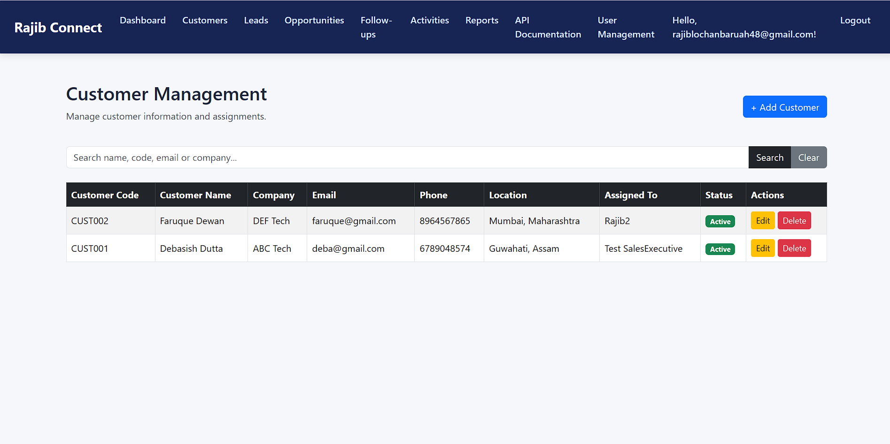
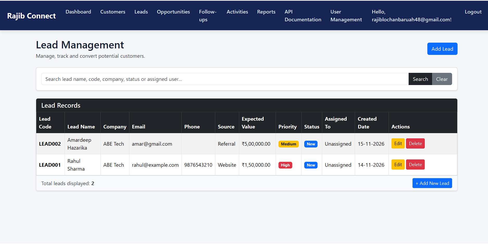
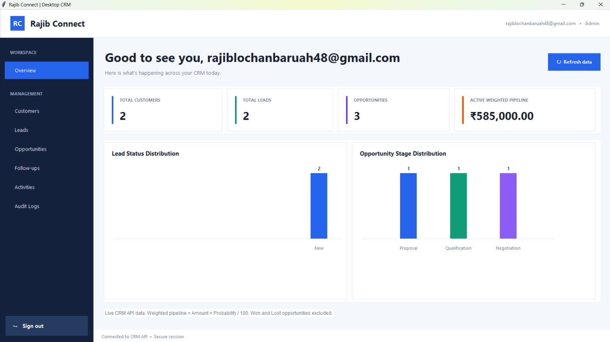

# Rajib Connect – Customer Relationship Management System

**Rajib Connect** is a Customer Relationship Management (CRM) application developed using ASP.NET Core MVC and Python. It provides a centralized platform for managing customers, leads, sales opportunities, follow-ups, activities, and CRM operations.

The project includes a web application and a separate Python desktop client that communicates with the backend through REST APIs.

## Project Overview

Rajib Connect consists of two main components:

- **Web Application and Backend:** ASP.NET Core MVC, Entity Framework Core, ASP.NET Core Identity, JWT authentication, and SQLite.
- **Desktop Application:** Python and Tkinter, integrated with the backend through REST APIs.

## Features

- User authentication and role-based authorization
- Customer management
- Lead management
- Sales opportunity management
- Follow-up and activity management
- Dashboard and CRM reporting
- Audit log management
- REST API integration
- JWT-based desktop-client authentication
- CSV export functionality in the desktop client

## Technology Stack

| Component | Technology |
|---|---|
| Backend | C#, ASP.NET Core MVC |
| ORM | Entity Framework Core |
| Authentication | ASP.NET Core Identity, JWT |
| Database | SQLite |
| API | ASP.NET Core Web API |
| Frontend | HTML, CSS, JavaScript, Bootstrap |
| Desktop client | Python, Tkinter |
| HTTP communication | Python Requests |
| Version control | Git, GitHub |


## Application Screenshots

### Web Application

**Dashboard**



**Customer Management**



**Lead Management**



### Desktop Application

**Python Desktop CRM**




## Architecture

```text
                  RAJIB CONNECT CRM
                          |
             +------------+------------+
             |                         |
       Web Application           Desktop Client
       ASP.NET Core MVC          Python / Tkinter
             |                         |
             |                    REST API Calls
             |                         |
             +------------+------------+
                          |
                    ASP.NET Core
                      Web API
                          |
                 Authentication
                    JWT / Identity
                          |
                 Entity Framework Core
                          |
                       SQLite
```

## Repository Structure

```text
Rajib-Connect/
|
+-- Backend/
|   +-- AcxiomCRM/
|       +-- Authorization/
|       +-- Controllers/
|       +-- Data/
|       +-- Migrations/
|       +-- Models/
|       +-- Services/
|       +-- Views/
|       +-- wwwroot/
|       +-- AcxiomCRM.csproj
|       +-- Program.cs
|
+-- DesktopClient/
|   +-- RajibConnect_Desktop/
|       +-- assets/
|       +-- gui_client.py
|       +-- requirements.txt
|       +-- setup.bat
|       +-- run.bat
|       +-- README.md
|
+-- Documentation/
+-- Screenshots/
+-- .gitignore
+-- README.md
```

## Requirements

### Backend

- .NET 10 SDK
- SQLite
- Visual Studio or Visual Studio Code

### Desktop Client

- Windows
- Python 3.13 or a compatible version
- Tkinter support
- Network access to the running backend

## Installation and Execution

### 1. Clone the repository

```bash
git clone https://github.com/Rajuna01/Rajib-Connect.git
cd Rajib-Connect
```

### 2. Run the backend

Open PowerShell or a terminal:

```powershell
cd Backend/AcxiomCRM
dotnet restore
dotnet build
dotnet run
```

Configure the database connection, JWT settings, and administrator email securely before starting the application.

The application displays its local web and API addresses when it starts.

### 3. Run the desktop client

Open another terminal:

```powershell
cd DesktopClient/RajibConnect_Desktop
```

Create the Python virtual environment and install dependencies:

```powershell
.\setup.bat
```

Launch the desktop application:

```powershell
.\run.bat
```

Configure the desktop client's API base URL to match the running backend.

## Authentication and Security

- ASP.NET Core Identity handles user authentication.
- Role-based authorization controls access to CRM features.
- The desktop client authenticates through the backend login API.
- JWT bearer tokens are used for authenticated API requests.
- Never commit passwords, signing keys, access tokens, or real customer records.
- Configure production secrets through a secure configuration provider.
- Use HTTPS for deployment.

## Project Status

The web application and Python desktop client have been developed and tested in the local development environment.

Production deployment and configuration may require additional setup.

## Future Enhancements

- Advanced CRM analytics and visualization
- Enhanced reporting
- Improved web and desktop synchronization
- Cloud deployment
- Additional integrations and automation

## License

No open-source license has been assigned to this repository. All rights are reserved by the project owner unless a license is added.

---

**Rajib Connect – CRM Web Application and Desktop Client**
